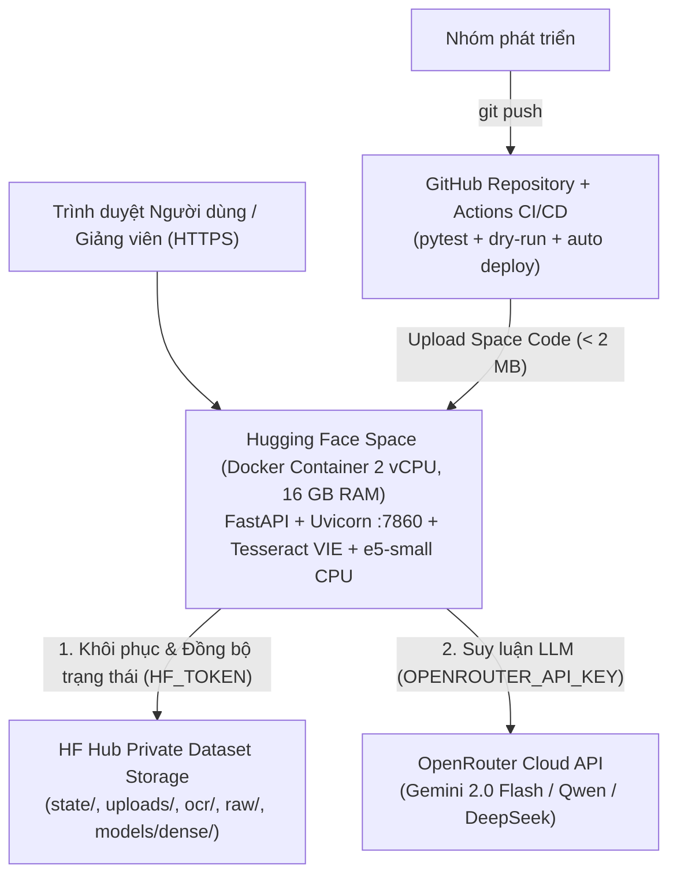
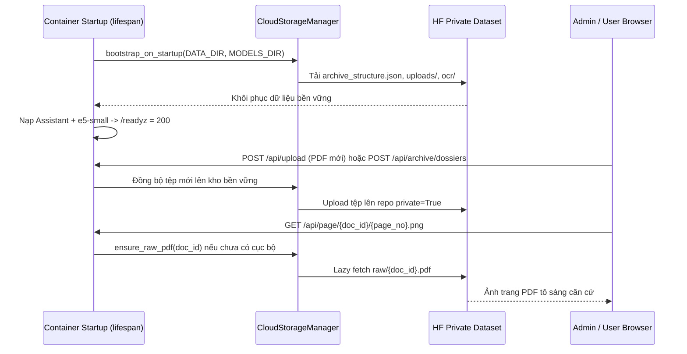

# Kế hoạch Triển khai Kỹ thuật (Implementation Plan)

**Branch**: `001-cloud-native-rag-archive` | **Date**: 2026-11-25 | **Spec**: [spec.md](./spec.md)

## Summary

Thiết kế và hoàn thiện hệ thống **Tra cứu và Hỏi đáp Tài liệu Lưu trữ Số hóa trên Hạ tầng Đám mây Công cộng**, tách bạch hoàn toàn khỏi không gian học phần NLP. Hệ thống tái cấu trúc lõi xử lý tài liệu (OCR Tesseract + Bigram Viterbi + tìm kiếm lai BM25/TF-IDF/`multilingual-e5-small` + Grounded RAG) sang kiến trúc 4 tầng: **Compute Container phi trạng thái (Hugging Face Spaces Docker SDK)**, **Cloud Storage bền vững riêng tư (HF Hub Dataset `private=True` / Docker Volume)**, **SaaS LLM Gateway (OpenRouter API)** và **Cloud CI/CD (GitHub Actions)**, đồng thời bổ sung xác thực phi trạng thái `HMAC-SHA256`, các điểm cuối giám sát sức khỏe (`/healthz`, `/readyz`, `/api/cloud/status`) và bảng điều khiển `/cloud`.

## Technical Context

- **Language/Version**: Python 3.10
- **Primary Dependencies**: FastAPI, Uvicorn, PyMuPDF (`pymupdf`), `pytesseract`, `scikit-learn`, `numpy`, `torch` (CPU), `transformers`, `huggingface_hub`
- **Storage**: 3 tầng — Container Image (bất biến), Hugging Face Hub Private Dataset / Docker Volume (bền vững), Local Runtime Cache (tạm thời)
- **Testing**: `pytest` (kế thừa bộ kiểm thử chức năng lõi + 4 bộ kiểm thử đám mây mới)
- **Target Platform**: Linux Container (`python:3.10-slim` trên Hugging Face Spaces 2 vCPU / 16 GB RAM và Docker Compose cục bộ)
- **Project Type**: Cloud-Native Web Application (FastAPI Backend + Multi-view Static Frontend + Cloud Observability Dashboard)
- **Performance Goals**: `/healthz` < 100 ms; gói mã nguồn Space chế độ `decoupled` < 5 MB; khôi phục 100% dữ liệu sau khởi động lại Container
- **Constraints**: Không chạm `Du_an/`; không yêu cầu thẻ tín dụng; không rò rỉ `.env` hoặc khóa bí mật; báo cáo 07 phần tuân thủ quy tắc văn phong học thuật `AGENTS.md`

## Constitution Check

- [x] **I. Cô lập NLP:** Tất cả tệp mới và chỉnh sửa chỉ nằm trong `Dien_toan_dam_may/`.
- [x] **II. Stateless Compute vs Durable Storage:** Đã tách qua `src/cloud_store.py` (`hf_dataset` / `local_volume`).
- [x] **III. Zero-Credit-Card Governance:** Dùng Hugging Face Spaces miễn phí + Private Dataset + OpenRouter kiểm soát quota.
- [x] **IV. Bảo mật & Quyền riêng tư:** Token ký `HMAC-SHA256`, Dataset ép `private=True`, cấm ghi `.env` trong container (`CLOUD_STATELESS_ENV=1`).
- [x] **V. Observability:** Có `/healthz`, `/readyz`, `/api/cloud/status`, `/api/cloud/sync`, `/cloud`, Docker `HEALTHCHECK`.
- [x] **VI. Học thuật:** Bản thảo `reports/BAO_CAO_DIEN_TOAN_DAM_MAY.md` viết theo 07 phần quy định.

## Kiến trúc Tổng thể Đám mây





## Project Structure

```text
Dien_toan_dam_may/
├── .agents/skills/                     # SpecKit Antigravity skills
├── .github/workflows/ci-cd-cloud.yml   # Pipeline CI/CD GitHub Actions
├── .specify/                           # Cấu trúc chuẩn SpecKit (constitution, scripts, templates)
├── specs/001-cloud-native-rag-archive/ # Spec, Research, Plan, Data Model, Contracts, Quickstart, Tasks
├── src/                                # 24 module runtime kế thừa + cloud_store.py + telemetry.py
├── web/
│   ├── app.py                          # FastAPI nâng cấp Cloud-Native
│   └── static/                         # index.html, notebooklm.*, cloud.html
├── data/                               # manifest, archive_structure, processed, ocr, 10 PDF mẫu
├── models/                             # refusal_threshold.json, spellfix_lm.pkl, dense/
├── scripts/deploy_cloud.py             # Kịch bản deploy decoupled / standalone
├── tests/                              # Kiểm thử kế thừa + 4 bộ kiểm thử cloud mới
├── reports/BAO_CAO_DIEN_TOAN_DAM_MAY.md# Báo cáo học thuật 07 phần
├── Dockerfile
├── docker-compose.yml
├── requirements-deploy.txt
├── hf_space_readme.md
├── .env.example
├── .dockerignore
└── README.md
```

## Phân công Công việc Nhóm (4 Gói Công việc Đồng đều)

| Gói công việc | Phạm vi phụ trách chính | Kết quả đầu ra kiểm chứng |
|---|---|---|
| **Gói 1: Phân tích Thiết kế & Quản trị Đặc tả** | Viết tài liệu SpecKit (`constitution`, `spec`, `research`, `data-model`, `plan`), thiết kế mô hình phân tầng dữ liệu | Bộ hồ sơ đặc tả hoàn chỉnh, sơ đồ kiến trúc và phân công |
| **Gói 2: Lưu trữ Bền vững & Đóng gói Container** | Xây dựng `cloud_store.py`, tối ưu `Dockerfile`, `docker-compose.yml`, kịch bản `deploy_cloud.py` tách dữ liệu | Gói triển khai < 5 MB, khôi phục 100% dữ liệu sau khởi động lại |
| **Gói 3: Bảo mật Phi trạng thái & Giám sát Đám mây** | Nâng cấp xác thực `HMAC-SHA256`, xây dựng `telemetry.py`, API `/healthz`, `/readyz`, `/api/cloud/*`, giao diện `/cloud` | Bảng điều khiển `/cloud` hiển thị chỉ số thật, kiểm thử auth đạt 100% |
| **Gói 4: Tự động hóa CI/CD, Kiểm thử & Báo cáo** | Thiết lập GitHub Actions, viết bộ kiểm thử cloud, triển khai demo thực tế và hoàn thiện báo cáo 07 phần | Pipeline xanh 100% `pytest`, URL demo công cộng và báo cáo nộp |
